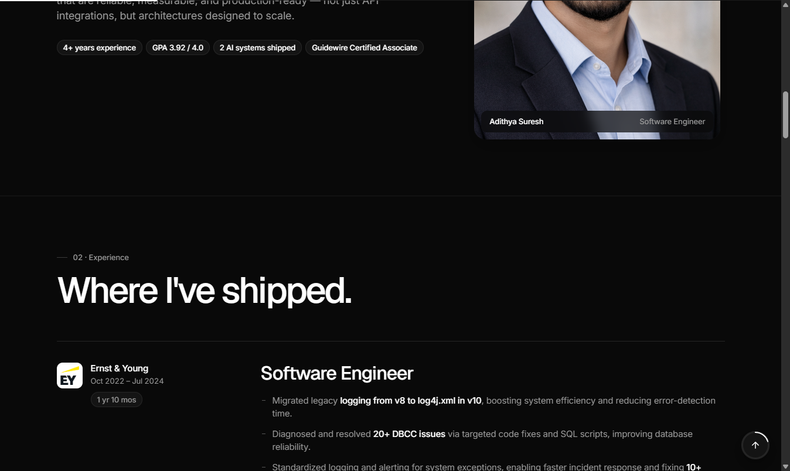

# Adithya Suresh — Portfolio

Personal portfolio of **Adithya Suresh**, Software Engineer with 4+ years of enterprise experience in distributed systems and cloud-native backends, focused on applied AI engineering — RAG pipelines, LLM orchestration, and multi-agent systems.

**Live site → [adithya280399.github.io/MyPortfolio](https://adithya280399.github.io/MyPortfolio/)**



## Sections

- **About** — background and focus areas
- **Experience** — EY (Software Engineer, Associate Software Engineer), Bharat Electronics Limited (Intern)
- **Skills** — AI & data, languages, backend & databases, cloud & DevOps, tools
- **Projects** — filterable project grid, including the Geopolitical Risk Intelligence Agent and Healthcare AI Chatbot
- **Education** — M.S. Information Science (University of North Texas), B.E. Electronics & Communication Engineering
- **Credentials** — certifications and awards
- **Contact** — email, LinkedIn, GitHub, resume and cover letter downloads

## Features

- Dark, responsive single-page layout
- Scroll-reveal animations and a scroll progress indicator (respects `prefers-reduced-motion`)
- Command palette for quick navigation — press <kbd>Ctrl</kbd> + <kbd>K</kbd>
- Project filtering by category and technology
- Downloadable resume and cover letter

## Tech stack

Plain **HTML**, **CSS**, and **vanilla JavaScript**: no frameworks and no build step. Hosted on **GitHub Pages**.

```
index.html     page markup
styles.css     styles and design tokens
script.js      interactions (nav, reveal, command palette, filters)
images/        photos and logos
*.pdf          resume and cover letter
```

## Run locally

Clone the repo and open `index.html` in a browser, or serve the folder:

```bash
git clone https://github.com/Adithya280399/MyPortfolio.git
cd MyPortfolio
npx serve .
```

## Contact

- Email: [adithyasuresh470@gmail.com](mailto:adithyasuresh470@gmail.com)
- LinkedIn: [adithya-suresh](https://www.linkedin.com/in/adithya-suresh-044435166/)
- GitHub: [@adithya280399](https://github.com/adithya280399)
